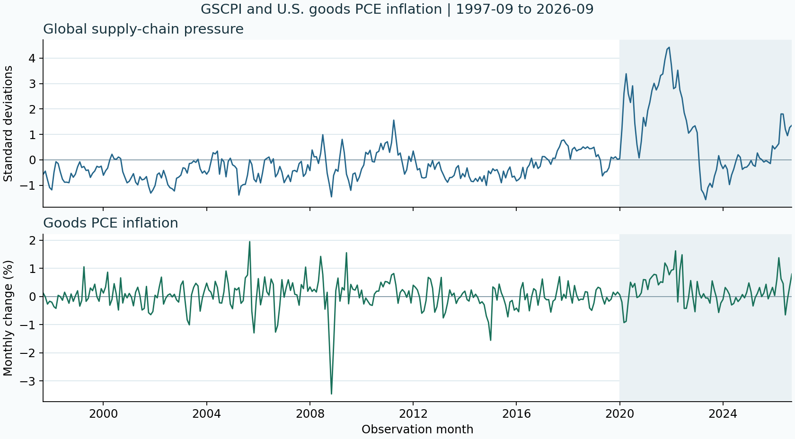
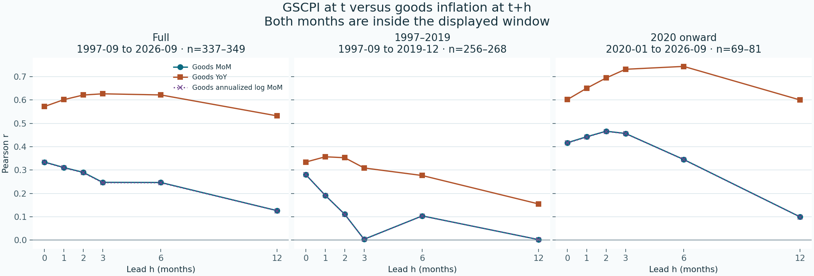
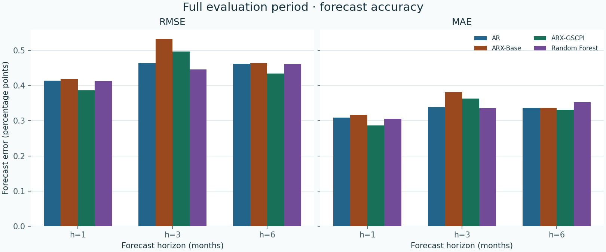
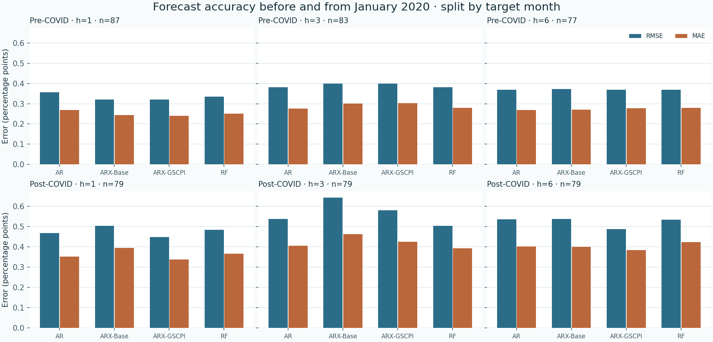
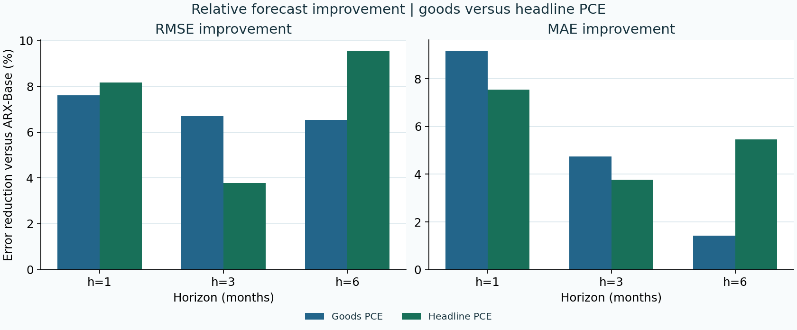
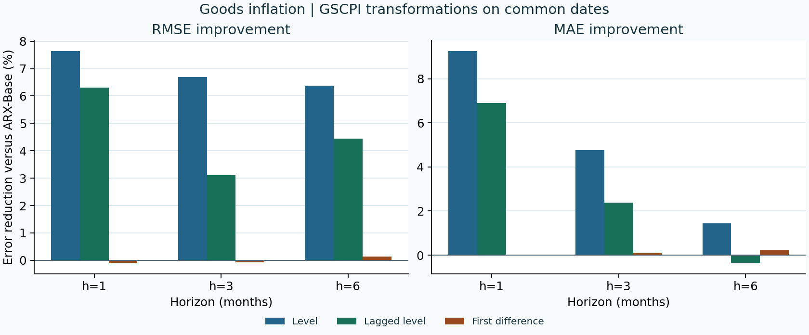

# 全球供应链压力与美国商品通胀预测

**Global Supply Chain Pressure and U.S. Inflation Forecasting**

## 摘要

本文检验纽约联储全球供应链压力指数（GSCPI）能否为美国个人消费支出（PCE）商品价格环比提供增量样本外预测信息。研究使用 1997 年 9 月至 2026 年 9 月的修订后月度数据，按观测月索引进行伪样本外预测。分别在 1、3 和 6 个月期限估计 AR、含原油和失业率控制量的 ARX、再加入 GSCPI 的 ARX，以及使用相同特征的随机森林。模型以 180 条有效记录为初始样本，逐月扩展训练窗并重新估计。每个预测起点只纳入标签观测月已经到达的训练记录。

加入 GSCPI 水平值后，三个期限的商品通胀 RMSE 均低于同组 ARX 基准。三个 Clark–West 检验在对期限进行 Holm 校正后仍达到 5% 水平。以四个模型的全期原始误差衡量，含 GSCPI 的线性模型在 1 和 6 个月领先，随机森林在 3 个月领先。随机森林与对应线性模型的双侧 Diebold–Mariano 检验在三个期限均未达到 5%。按目标月份分期后，2020 年起组的 GSCPI 增量证据更集中。

整体 PCE 也有增益，但商品与整体的相对改善随期限和误差指标而变。共同样本中，GSCPI 水平优于其滞后水平和一阶差分。使用最近 180 条完整训练记录的滚动窗，也保留了三个期限的增量预测证据。研究结果适用于当前修订快照，实际历史发布日期和首次发布值仍有待重建。

**关键词**　全球供应链压力指数 · 商品 PCE · 样本外预测 · 随机森林 · Clark–West 检验

<!-- pagebreak -->

## 1　引言

### 1.1 研究问题

美国商品价格会受到国际运费、投入品短缺、库存周转与国内需求变化的共同影响。WTI 的月度变化记录全球能源价格的波动，失业率月差提供美国劳动力市场的短期变化信号。即便控制这些变量，交货等待时间、订单积压和运输瓶颈仍可能提供不同维度的信息。本文的问题是：**GSCPI 能否在这些已有信息之外，改善美国商品 PCE 通胀的样本外预测？**

研究将预测目标设为商品 PCE 价格指数月环比。以月度通胀为目标，可把预测期限直接解释为目标月与起点月的观测期差，也减少同比重叠带来的机械持久性。商品 PCE 对可贸易品和生产物流成本存在较直接的经济联系。整体 PCE 同时纳入服务项目，因而适合作为目标替换的稳健性检验。

### 1.2 比较的经济含义

核心比较是 ARX-GSCPI 对 ARX-Base。两者的训练行、商品通胀历史、WTI 和失业率控制一致，新增项为 GSCPI。这个比较衡量 GSCPI 相对于给定控制集的增量预测信息。完整 ARX-GSCPI 对简单 AR 的原始误差比较则同时涉及全部外部变量。以历史样本中最小的 RMSE 或 MAE 排序，回答的是给定指标下哪组预测误差较小。是否存在有统计证据的增量预测信息，要依据相应的配对检验。

随机森林和 ARX-GSCPI 使用完全相同的特征，因而可以考察改变映射形式是否产生额外增益。本文采用直接多步预测，三个期限各自估计，重点解读 1、3 个月，6 个月作为补充。对疫情前后、目标定义、GSCPI 形式和训练窗口的比较帮助定位结论适用范围。

### 1.3 研究路径

先检查数据覆盖、变换与时序依赖，再在固定时间次序下比较样本外预测。正式推断对嵌套模型使用 Clark–West，对随机森林和线性 ARX-GSCPI 使用 Diebold–Mariano。全文区分描述性关联、原始预测误差以及调整损失差检验。

<!-- pagebreak -->

## 2　文献综述

### 2.1 全球供应链压力的测量

Benigno、di Giovanni、Groen 和 Noble（2022）把运输成本和制造业供应链指标汇总为 GSCPI。运输成本反映物流稀缺程度，制造业调查中的交货时间和积压订单反映生产过程的延滞。综合指数保留多个经济体共同波动的成分，便于同美国价格序列进行月度比较。指数水平表示相对长期均值的标准化偏离。本研究据此把水平作为主规格，另用滞后一个月的水平和月差检验预测信息是否依赖同期状态。

GSCPI 包含持续的拥堵状态。举例来说，若港口延误已处于高位，指数当月变化即使接近零，企业仍可能面临较长的交付周期或较高的安全库存要求。水平、滞后水平和月差因此有不同的经济含义。前者关注状态，滞后值关注此前状态，差分关注压力正在加剧或缓解的速度。

### 2.2 从运输到消费价格的传导

Liu 和 Nguyen（2023）讨论了供应链冲击如何通过商品生产投入成本和通胀预期影响美国 PCE。他们以局部投影识别意外压力变化，区分商品价格与整体 PCE 的响应，并讨论疫情期间供应压力的变化。海运和空运费用进入到岸成本，交期和投入短缺还可能提高补库成本。若企业逐步把成本转到批发、零售或进口终端商品上，消费价格变化可能出现在运输和投入信号之后。

传导受到合同重定价、汇率、库存、利润率及需求条件影响。成本变化也可能由企业利润吸收。整体 PCE 的服务部分受工资、租金与本地需求等因素影响，供应链压力的相对预测增益因服务权重和商品权重而变。能源价格还影响部分服务成本，因此整体 PCE 同样可能受供应约束信息影响。

### 2.3 供应链关系的时变性

Mrabet 等（2025）使用 2000–2021 年美国和欧盟数据研究供应压力与消费者价格的时变关系，发现关联在金融危机和疫情等阶段较突出。本文使用该研究作为分期考察的动机。该文考察 CPI，本文以 PCE 作为预测对象，使用直接多步预测框架。按 2020 年切分的结果用于描述数据阶段，经济因果机制需要额外识别。

<!-- pagebreak -->

## 2　文献综述（续）

### 2.4 数据丰富条件下的机器学习预测

Medeiros、Vasconcelos、Veiga 和 Zilberman（2021）以数据丰富的美国通胀预测为背景，比较传统基准与机器学习方法，其随机森林在原始实验中表现突出。树模型可按特征区间切分样本，因而允许能源价格与供应压力的组合、以及不同压力水平下的非对称关系。本文特征集较小，使用随机森林是为了在与线性模型共用特征和评价日期的条件下比较这一灵活性。

Naghi、O’Neill 和 Danielova Zaharieva（2024）复现了 Medeiros 等原研究的主要结果，并加入更多模型和国家，同时延长评价样本。扩展结果显示，多个方法与随机森林具有竞争力，疫情及随后的高通胀阶段尤其增加了随机森林的预测困难。该研究提示模型表现受评价样本、目标和替代方法影响。本文据此保留朴素 AR，并把 2020 年前后误差分开报告。

Liu、Pan 和 Xu（2024）对日本核心通胀进行直接 1、3、6 个月预测，将较多候选变量用于机器学习模型，发现其 2023 年回测中惩罚回归、尤其 LASSO 表现较好。日本核心通胀及其评价期间均有不同背景。本文借鉴期限独立估计和按时间排序的评价设计，因研究问题聚焦 GSCPI 的边际信息而采用四种预设模型。

### 2.5 对本文识别范围的启示

文献提供两类理由。第一，运输和制造环节的压力与价格形成存在经济联系，值得把指数作为外部预测量。第二，方法排序需要在清楚定义的目标、基准和样本上度量，尤其要照顾疫情前后分布差异。本文的设计检验模型能否使用已有指数减小未来观测误差。若 GSCPI 与需求旺盛或国际能源供给同时变动，模型可能利用其综合信息。即使预测改进，仍须另行论证其中有多少可归因于某一种外生冲击。

<!-- pagebreak -->

## 3　数据与描述性分析

### 3.1 来源、定义与覆盖

| 字段 | 来源 | 进入模型的形式 |
| --- | --- | --- |
| 商品 PCE 链式价格指数 | BEA，经 FRED DGDSRG3M086SBEA | 季调指数的非年化月环比 |
| 整体 PCE 链式价格指数 | BEA，经 FRED PCEPI | 季调指数的非年化月环比 |
| GSCPI | 纽约联储 | 标准化水平 |
| WTI 库欣现货价 | EIA，经 FRED MCOILWTICO | 100 × 月度对数变化 |
| 美国失业率 | BLS，经 FRED UNRATE | 月度百分点差分 |

Pₜ 为对应 PCE 价格指数，πₜ 为以百分比计的月环比。WTI 水平以美元每桶计，失业率水平以百分比计。原始数据和处理版本来自既有项目快照。共同观测范围为 1997-09 至 2026-09，共 349 个日历月。用于初期通胀滞后构造的更早 PCE 观测来自 Task 0，训练起点仍限制在共同区间。

$$
\pi_t=100\left(\frac{P_t}{P_{t-1}}-1\right)
$$

2025 年 10 月，美国住户调查因联邦政府停摆未采集，失业率缺失。相邻月份差分使 2025 年 10 月和 11 月的失业率变化均空缺。两个起点在比较组内共同跳过，并由不同预测期限映射到相应目标月。疫情极端值及其他有效观测均保留。

### 3.2 全期描述统计

| 变量 | 有效月数 | 均值 | 标准差 | 最小 | 最大 | 超额峰度 |
| --- | --- | --- | --- | --- | --- | --- |
| 商品 PCE 月环比 | 349 | 0.076 | 0.507 | -3.459 | 1.954 | 7.881 |
| 整体 PCE 月环比 | 349 | 0.181 | 0.213 | -1.180 | 0.965 | 6.470 |
| GSCPI 水平 | 349 | -0.004 | 0.999 | -1.563 | 4.426 | 4.588 |
| WTI 对数月变化 | 349 | 0.454 | 10.111 | -56.813 | 54.562 | 7.546 |
| 失业率月差 | 347 | -0.002 | 0.612 | -2.200 | 10.400 | 243.162 |

超额峰度采用 Fisher 定义，正态分布基准为零。水平和变换单位不同，标准差用于变量自身的波动描述。

<!-- pagebreak -->

## 3　数据与描述性分析（续）

**图 1　GSCPI 与美国商品 PCE 月环比**

> 2020 年起两序列出现明显波动，GSCPI 在 2021 年末达到样本峰值，商品通胀环比随后仍经历多次反转。

| 变量 | 疫情前均值 | 疫情前标准差 | 2020 年起均值 | 2020 年起标准差 |
| --- | --- | --- | --- | --- |
| 商品 PCE 月环比 | 0.031 | 0.501 | 0.227 | 0.497 |
| 整体 PCE 月环比 | 0.147 | 0.199 | 0.294 | 0.219 |
| GSCPI 水平 | -0.308 | 0.485 | 1.002 | 1.492 |
| WTI 对数月变化 | 0.410 | 8.651 | 0.599 | 13.962 |
| 失业率月差 | -0.004 | 0.156 | 0.006 | 1.256 |

分期按观测月划分。2020 年起商品环比均值上移，环比标准差在这两个长区段接近。GSCPI 的均值及标准差明显高于疫情前区段，表中差异属于样本描述。失业率月差的标准差上升较多，其中疫情初期一次大幅上升对尾部形状有重要影响。

商品环比呈左偏，整体环比和 WTI 变化也有明显尾部观测。本文保留这些月度价格反转和跳升，让预测误差反映模型对实际观测的跟踪成本。全样本误差可能受少数大幅波动月份拉动，因此同时报告偏重尾部的 RMSE 和按绝对幅度计权的 MAE。

<!-- pagebreak -->

## 3　时序诊断与领先关系

**图 2　GSCPI 与未来商品通胀的探索性相关**

> GSCPI 与次月商品环比的领先相关为 0.311，疫情前为 0.192，2020 年起为 0.443。

| 领先期 h | 全期 | 2020 年前 | 2020 年起 |
| --- | --- | --- | --- |
| 0 | 0.334 | 0.280 | 0.417 |
| 1 | 0.311 | 0.192 | 0.443 |
| 2 | 0.290 | 0.111 | 0.466 |
| 3 | 0.247 | 0.004 | 0.457 |
| 6 | 0.247 | 0.104 | 0.345 |
| 12 | 0.126 | 0.002 | 0.100 |

相关定义是 corr(GSCPIₜ, πₜ₊ₕ)，两个观测月份均在所属时期内。同比窗口重叠较多，环比的领先结果更贴近本文预测目标。相关图用于描述依赖结构，实际预测增量由滚动起点的模型比较检验。

| 变量 | 连续诊断样本 n | ADF p | KPSS p |
| --- | --- | --- | --- |
| 商品 PCE 月环比 | 349 | 2e-21 | >0.1000 |
| 整体 PCE 月环比 | 349 | 9.96e-09 | 0.0528 |
| GSCPI 水平 | 349 | 0.0027 | <0.0100 |
| WTI 对数月变化 | 349 | 7.74e-21 | >0.1000 |
| 失业率月差 | 337 | 1.37e-19 | >0.1000 |
| GSCPI 月差 | 348 | 2.19e-26 | >0.1000 |

ADF 原假设为单位根，KPSS 原假设为水平平稳。两项检验对 GSCPI 水平给出不同类型的拒绝，而月差支持水平平稳近似。由于水平有明确经济含义，保留其主规格，并检验差分。失业率月差的连续诊断样本止于 2025 年 9 月，缺月后的有效观测仍用于其他合适的分析。

<!-- pagebreak -->

## 4　预测方法

### 4.1 直接多步预测与线性模型

t 表示起点的月度观测索引，h 是目标月相对起点月的观测期差。AR 使用商品通胀当期及可用的若干前期值，pₕ 为该期限采用的固定阶数。αₕ 是截距，φₕ,ᵢ 是线性历史项系数。

$$
\hat\pi_{t+h}^{AR}=\alpha_h+\sum_{i=0}^{p_h-1}\phi_{h,i}\pi_{t-i}
$$

ARX-Base 在上述预测值上加入 βₕ,₁Wₜ 和 βₕ,₂ΔUₜ。Wₜ 是 WTI 的月对数变化，ΔUₜ 是失业率的百分点变化。将两项加总后的 ARX-Base 预测记作带上标 B 的预测。完整的 ARX-GSCPI 在此基础上增加 Gₜ，后者是 GSCPI 水平，βₕ,₃ 描述给定其他预测量后的线性斜率。三个线性模型以带截距的 OLS 按期限分别重新估计。

$$
\hat\pi_{t+h}^{G}=\hat\pi_{t+h}^{B}+\beta_{h,3}G_t
$$

### 4.2 随机森林

Xₜ 包括 pₕ 个商品通胀历史项、WTI 月对数变化、失业率月差和 GSCPI，与 ARX-GSCPI 完全相同。Tₕ,ᵦ 是第 b 棵回归树。随机森林对 300 棵树的预测取平均。树深、最小叶节点样本数和每次分裂的候选特征比例通过初始窗口中的五折时间序列交叉验证选择，训练与验证间隔为 h，随机种子固定为 42。

$$
\hat\pi_{t+h}^{RF}=\frac{1}{300}\sum_{b=1}^{300}T_{h,b}(X_t)
$$

每个期限独立选择 pₕ。在最初 180 条共有有效观测上，以 1 至 6 阶的 AR 高斯 AIC 选阶。主规格三个期限分别选择 2、1 和 1 阶，全部模型在各自的期限沿用该阶数。RF 参数选定后固定。特征在起点月形成，响应是目标月通胀，直接估计避免为未来控制变量另设预测方程。

<!-- pagebreak -->

## 4　评价与推断

### 4.3 扩展窗口与信息截止

初始样本为 180 条有效训练记录。若训练行的起点为 s，模型拟合时只接纳满足 s+h≤t 的目标标签。获得下一预测起点时，模型用新的可用训练记录重新估计。四种模型在每个期限使用同一训练行和同一评价日期。

| h | 首个起点 | 首个目标 | 末个目标 | 预测 n | 2020 年前 / 起 |
| --- | --- | --- | --- | --- | --- |
| 1 | 2012-09 | 2012-10 | 2026-09 | 166 | 87 / 79 |
| 3 | 2012-11 | 2013-02 | 2026-09 | 162 | 83 / 79 |
| 6 | 2013-02 | 2013-08 | 2026-09 | 156 | 77 / 79 |

使用的是修订快照，故实验为 **Observation-indexed Pseudo Out-of-Sample Forecasting**。观测月约束了样本时间顺序。历史发布日期与首次可见版本另需重建。

### 4.4 误差度量与统计检验

yₜ 表示评价目标月的实际环比，预测值以帽号表示，N 为配对月份数。RMSE 与 MAE 均以百分点计，前者对极端误差赋予更大权重。平均误差另在预测结果表中保存。

$$
\mathrm{RMSE}=\sqrt{\frac{\sum_t e_t^2}{N}},\quad \mathrm{MAE}=\frac{\sum_t|e_t|}{N},\quad e_t=y_t-\hat y_t
$$

嵌套模型记为受限 R 和非受限 U。Clark–West 的调整损失差将预测值之差平方加回，以考虑额外系数估计引入的噪声。检验 E(dₜ)≤0 对 E(dₜ)>0，使用右尾正态近似。

$$
d_t=e_{R,t}^2-e_{U,t}^2+(\hat y_{R,t}-\hat y_{U,t})^2
$$

非嵌套比较使用随机森林减线性 ARX-GSCPI 的平方损失差及双侧 Diebold–Mariano 检验。两类比较使用 Bartlett 权重及 h−1 阶 HAC。Task 3 新计算按连续日历区段配对，有缺月时排除跨缺口的自协方差项。对冻结主结果的 Holm 校正沿用 Task 2.1 原始 p 值。

<!-- pagebreak -->

## 5　主要样本外预测结果

**图 3　四种模型的全期预测误差**

> 按两项原始误差，ARX-GSCPI 在 1 和 6 个月领先，随机森林在 3 个月领先。

| h | 指标 | AR | ARX-Base | ARX-GSCPI | RF |
| --- | --- | --- | --- | --- | --- |
| 1 | RMSE | 0.4138 | 0.4186 | 0.3867 | 0.4129 |
| 1 | MAE | 0.3088 | 0.3159 | 0.2869 | 0.3060 |
| 3 | RMSE | 0.4640 | 0.5326 | 0.4969 | 0.4456 |
| 3 | MAE | 0.3388 | 0.3806 | 0.3626 | 0.3351 |
| 6 | RMSE | 0.4617 | 0.4640 | 0.4337 | 0.4604 |
| 6 | MAE | 0.3364 | 0.3365 | 0.3317 | 0.3524 |

沿用 Task 2.1 的 166、162 和 156 个配对目标月。单位为百分点。商品通胀的主规格中，相对有 WTI 和失业率控制的 ARX-Base，加入 GSCPI 在三个期限均降低 RMSE 和 MAE。以 RMSE 衡量，相对改善约为 7.61%、6.70% 和 6.54%。

相对简单 AR，完整 ARX-GSCPI 在 1 和 6 个月取得更低误差，在 3 个月两项误差均高于 AR。ARX-Base 单独与 AR 比较时，三个期限的原始 RMSE 和 MAE 均较高。是否保留某组控制量，需要结合需要回答的边际问题、误差和相应配对检验。

<!-- pagebreak -->

## 5　增量检验与多重校正

### 5.1 Clark–West 与 Holm 家族

| 受限 → 非受限 | h | CW | 原始 p | Holm p | 5% 前 / 后 |
| --- | --- | --- | --- | --- | --- |
| AR → ARX-Base | 1 | +3.069 | 0.0011 | 0.0032 | 拒绝 / 拒绝 |
| AR → ARX-Base | 3 | -1.791 | 0.9633 | 1.0000 | 保留 / 保留 |
| AR → ARX-Base | 6 | -1.198 | 0.8846 | 1.0000 | 保留 / 保留 |
| ARX-Base → ARX-GSCPI | 1 | +2.989 | 0.0014 | 0.0042 | 拒绝 / 拒绝 |
| ARX-Base → ARX-GSCPI | 3 | +2.202 | 0.0138 | 0.0276 | 拒绝 / 拒绝 |
| ARX-Base → ARX-GSCPI | 6 | +1.836 | 0.0332 | 0.0332 | 拒绝 / 拒绝 |

按每类比较的三个期限分别构建检验家族。对 p 值由小到大排序，对最小值乘 3、第二小乘 2、最大值乘 1，按排序取累积最大并截断在 1，再还原期限顺序。表中“保留”指未拒绝原假设。校正后的判断与未校正时一致。GSCPI 的三个期限均拒绝无增量信息的原假设，短期的校正 p 值最低。

WTI 和失业率的联合增量只在 1 个月得到校正后检验支持。Clark–West 衡量经预测差调整后的损失差，而原始误差排名来自实际预测残差。误差和调整检验分别回答有限样本中预测得多准，以及已有结果是否为额外变量的信息贡献提供证据。

### 5.2 随机森林与线性模型

| h | n | RF − ARX-GSCPI 损失差 | DM | 双侧 p |
| --- | --- | --- | --- | --- |
| 1 | 166 | +0.02091 | +1.366 | 0.1719 |
| 3 | 162 | -0.04832 | -1.033 | 0.3018 |
| 6 | 156 | +0.02394 | +1.221 | 0.2219 |

损失差定义为 RF 减 ARX-GSCPI，负值表示 RF 的样本平方损失较低。3 个月的 RF 相对 ARX-GSCPI 降低 RMSE 约 10.3%、MAE 约 7.6%，双侧 p 值为 0.3018，差异的统计证据有限。1 和 6 个月的损失方向均偏向线性模型，双侧检验也未达到 5%。使用最小原始误差描述模型排序，避免把排序当作显著性结论。

<!-- pagebreak -->

## 5　时期异质性

**图 4　按目标月份划分的预测误差**

> 四种模型在 2020 年起的 RMSE 和 MAE 均更高，3 个月的误差领先者由 AR 变为 RF。

| h | 目标时期 | n | 调整差 | CW | 单侧 p |
| --- | --- | --- | --- | --- | --- |
| 1 | 2020 年前 | 87 | +0.00331 | +0.876 | 0.1906 |
| 1 | 2020 年起 | 79 | +0.08518 | +2.973 | 0.0015 |
| 3 | 2020 年前 | 83 | -0.00020 | -0.221 | 0.5876 |
| 3 | 2020 年起 | 79 | +0.11581 | +2.319 | 0.0102 |
| 6 | 2020 年前 | 77 | +0.01024 | +1.427 | 0.0768 |
| 6 | 2020 年起 | 79 | +0.13163 | +1.812 | 0.0350 |

时期内 Clark–West 比较 ARX-GSCPI 和 ARX-Base。同一目标时段内分别估计调整损失差的均值及方差，它检验该时段的增量信息，跨期差异本身需要另设检验。疫情前组没有逐项 5% 的拒绝，2020 年起三个期限的逐项 p 值均低于 5%。每个后期样本仅有 79 个月，检验结果作为探索性异质性证据解读。

1 个月两期由 ARX-GSCPI 取得最低 RMSE 和 MAE。3 个月，两项误差的领先模型均由 AR 转为 RF。6 个月疫情前 RMSE 和 MAE 分别由 RF 和 AR 领先，后期均由 ARX-GSCPI 领先。分组包括疫情冲击、高通胀与后续恢复，分组结果会受冲击强度、样本构成及价格变量条件分布变化影响。

<!-- pagebreak -->

## 6　稳健性 A：整体 PCE 目标

**图 5　两种通胀目标的相对预测改善**

> 两种目标的 RMSE 均下降，商品相对改善在 3 个月更大，整体在 1 和 6 个月更大。

| h | 整体 RMSE 基准 → 扩展 | 整体 MAE 基准 → 扩展 | RMSE 改善 商品 / 整体 | MAE 改善 商品 / 整体 | 整体 CW / p |
| --- | --- | --- | --- | --- | --- |
| 1 | 0.1767 → 0.1622 | 0.1317 → 0.1218 | 7.61% / 8.18% | 9.18% / 7.54% | 3.258 / 0.0006 |
| 3 | 0.2593 → 0.2495 | 0.1661 → 0.1598 | 6.70% / 3.78% | 4.75% / 3.77% | 1.567 / 0.0585 |
| 6 | 0.2065 → 0.1868 | 0.1444 → 0.1365 | 6.54% / 9.56% | 1.42% / 5.45% | 1.738 / 0.0411 |

整体 PCE 的自身历史滞后与目标标签同时替换。对一致的 180 条初始有效观测分别重新使用 AIC，三个期限均选 1 阶。固定目标和期限内，ARX-Base 与 ARX-GSCPI 使用同样训练长度和日期，评价月与商品主规格对齐。

表中改善率等于 100×(1−加入 GSCPI 后的误差／本目标基准误差)。整体 PCE 的 1、6 个月有逐项 5% 的 CW 证据，3 个月 p＝0.0585。对 RMSE 而言，商品在 3 个月相对增益更大，整体在 1 和 6 个月增益更大。对 MAE 而言，商品在 1 和 3 个月更大，整体在 6 个月更大。

比较的是模型内部相对改善比例。两个目标的波动尺度不同，绝对 RMSE 不能用来衡量哪种通胀更受 GSCPI 影响。这里也没有对改善率之差做正式检验，故经济解释应保留这种不确定性。

<!-- pagebreak -->

## 6　稳健性 B：GSCPI 变量形式

**图 6　共同样本上的三种 GSCPI 形式**

> 当期水平在三个期限的两项误差改善都最大，一阶差分的相对改善接近零。

| h | GSCPI 形式 | n | RMSE | MAE | RMSE 改善 | MAE 改善 | CW p |
| --- | --- | --- | --- | --- | --- | --- | --- |
| 1 | ARX-Base | 165 | 0.4194 | 0.3163 | +0.00% | +0.00% | — |
| 1 | 当期水平 | 165 | 0.3874 | 0.2870 | +7.65% | +9.26% | 0.0014 |
| 1 | 滞后水平 | 165 | 0.3930 | 0.2945 | +6.30% | +6.89% | 0.0042 |
| 1 | 一阶差分 | 165 | 0.4198 | 0.3163 | -0.10% | +0.02% | 0.4128 |
| 3 | ARX-Base | 161 | 0.5320 | 0.3798 | +0.00% | +0.00% | — |
| 3 | 当期水平 | 161 | 0.4964 | 0.3618 | +6.69% | +4.75% | 0.0141 |
| 3 | 滞后水平 | 161 | 0.5154 | 0.3708 | +3.11% | +2.39% | 0.0636 |
| 3 | 一阶差分 | 161 | 0.5324 | 0.3794 | -0.08% | +0.11% | 0.3187 |
| 6 | ARX-Base | 155 | 0.4657 | 0.3392 | +0.00% | +0.00% | — |
| 6 | 当期水平 | 155 | 0.4360 | 0.3343 | +6.38% | +1.43% | 0.0343 |
| 6 | 滞后水平 | 155 | 0.4450 | 0.3404 | +4.44% | -0.36% | 0.0422 |
| 6 | 一阶差分 | 155 | 0.4650 | 0.3384 | +0.14% | +0.22% | 0.2434 |

所有模型统一剔除无法构造滞后值与月差的 1997-09 初始行，评价月数随之各减少一个。各期限的四个模型共享训练行，重新按共同初始样本 AIC 选阶。变量差分为 Gₜ−Gₜ₋₁。

当期水平在三个期限均有逐项 5% 的增量证据。滞后水平在 1 和 6 个月达到该水平，6 个月 MAE 略升。月差的所有 p 值均高于 5%。结果表明所用模型更能利用持续的压力状态，当前样本对单月压力变化的增量证据较弱。

<!-- pagebreak -->

## 6　稳健性 C：训练窗口

### 6.1 窗口构造

对商品通胀的 ARX-Base 和 ARX-GSCPI 逐起点重新估计。扩展窗口保留全部可用训练历史。滚动窗口仅取最近 180 条完整且标签已达到起点月的记录。缺失月份不计入 180 条完整记录，窗口覆盖的实际日历长度可能略超过 180 个月。两种窗口的起点、目标及选阶保持一致。扩展窗口每个起点的预测值和训练截止月与冻结预测逐一核对。

| h | 窗口 | n | 基准 RMSE / MAE | 加入 GSCPI RMSE / MAE | RMSE 改善 | CW / 单侧 p |
| --- | --- | --- | --- | --- | --- | --- |
| 1 | 扩展 | 166 | 0.4186 / 0.3159 | 0.3867 / 0.2869 | 7.61% | 2.989 / 0.0014 |
| 1 | 滚动 | 166 | 0.4403 / 0.3219 | 0.4101 / 0.2931 | 6.85% | 3.241 / 0.0006 |
| 3 | 扩展 | 162 | 0.5326 / 0.3806 | 0.4969 / 0.3626 | 6.70% | 2.202 / 0.0138 |
| 3 | 滚动 | 162 | 0.5303 / 0.3816 | 0.4988 / 0.3617 | 5.94% | 2.086 / 0.0185 |
| 6 | 扩展 | 156 | 0.4640 / 0.3365 | 0.4337 / 0.3317 | 6.54% | 1.837 / 0.0331 |
| 6 | 滚动 | 156 | 0.5045 / 0.3626 | 0.4801 / 0.3549 | 4.84% | 1.709 / 0.0437 |

表中误差为百分点，RMSE 改善率相对于同窗口的 ARX-Base。加入 GSCPI 后，两种窗口下每个期限的 RMSE 和 MAE 均下降。滚动窗的三个 RMSE 改善分别为 6.85%、5.94% 和 4.84%，逐项 CW p 值均低于 5%。

### 6.2 窗口结果怎么解读

扩展窗中，ARX-GSCPI 的 1、3、6 个月 RMSE 均略低于同模型的滚动窗。3 个月的 MAE 则是滚动窗略低。固定长度能够让旧数据逐渐退出，权重更集中在近期，可能有利于适应关系变化，也会使可用于辨别稀有冲击的历史信息减少。此处 CW 检验的是**同窗口内部加入 GSCPI** 的增量，两个窗口的误差排序仅用于描述。

新 CW 在缺口处切断自协方差的连续区段。由于 Task 2.1 的冻结估计允许按正确日历滞后跨缺口配对，局部 p 值可有轻微变化，例如扩展窗口 6 个月。预测与误差数值不受这一推断约定影响。

<!-- pagebreak -->

## 7　经济学讨论

### 7.1 商品价格对供应链状态的暴露

制造业投入、跨境运输和进口商品会共同进入商品价格形成过程。供应压力偏高时，现货供应不足、零部件延迟与高运费可能同时出现。企业增加库存或向替代供应商采购会改变单位成本，零售价格的调整又可能滞后于批发和进口成本。Benigno 等提供了用综合指数追踪供应条件的思路，Liu 与 Nguyen 对商品成本和预期渠道的分析提供了美国通胀背景。

整体 PCE 内含服务消费，其波动同时与工资、租赁成本、国内需求及政策条件有关。商品更直接暴露于运输与投入瓶颈，仍不能由此推出商品通胀的预测增益必定更大。稳健性 A 对期限与指标的交叉比较表明，两种目标都可利用供应压力状态，商品优势主要体现在 3 个月的相对改善。

### 7.2 不同期限与不同函数形式

1 个月时，当前压力状态可能概括近期尚在消化的交货和成本信号，线性模型可用较少参数利用这种信息。6 个月的水平项可能帮助捕捉持续性，但估计也可能反映低频共同变化。对 3 个月而言，树可拟合紧张状态、能源波动或通胀惯性之间的交互。Medeiros 等提供了非线性方法有用的案例，Naghi 等的样本扩展与 Liu 等在日本的结果则说明预测优势取决于设计。本文 3 个月 RF 的误差排名与非线性可能有用相容，DM 检验尚不足以确认稳定优越性。

### 7.3 经济阶段与信息增量

疫情初段供应中断、需求转向商品和产能约束相互叠加。后续阶段还包括供应链缓解、库存重建及价格调整。T1 的领先相关与 T3 的时期内 CW 指向 2020 年起更明显的预测信号，与 Mrabet 等讨论的时变关系相呼应。分期的高误差反映后期环境更难预测，GSCPI 的相对增益可以在同时存在高绝对误差时扩大。跨期的结构性变化以及数据修订都可能影响相对排名。

<!-- pagebreak -->

## 8　局限

### 8.1 数据版本与发布日期

本文每个 t 都按观测月份索引输入，标签按目标观测月进行截断。历史实时预测还需重建每个起点能看到的首次公布数据、后续修订和发布日期。PCE、失业率与 GSCPI 的实际公布节奏可能不同，h＝1 特别容易受信息发布时间差影响。冻结快照上的结果应理解为观测索引条件下的伪样本外证据。

### 8.2 统计与经济解释

2020 年起的目标月各只有 79 个配对观测。两期显著性不同本身不能量化跨期参数差异。新增稳健性、分期 CW 使用逐项参考阈值，Holm 的控制范围限于两组预设主检验家族。HAC 的带宽设定针对多步重叠，并按月历缺口处理，有效样本仍可能存在其他来源的依赖。异常月份保留可避免事后挑样，同时也令误差及检验更受少数大冲击影响。

GSCPI 是汇总指标，有可能同时反映运输供给、全球需求、能源与库存变化。现有预测实验衡量增加指标后的信息贡献，无法从中单独分离运输、进口成本、需求或政策渠道。滞后 GSCPI 的稳健性可说明其过去值仍含信息，完整的实时可得性需要另做版本及发布日对齐。

## 9　结论

基于当前设计，**GSCPI 水平对商品 PCE 通胀提供增量样本外预测信息**。三个期限相对含 WTI 与失业率的受限模型均降低原始误差，并在预设 Holm 家族内通过 5% 检验。滚动窗也保留同方向的增量。更换目标后，整体 PCE 同样可见改进，比较优势随期限和误差指标而变。滞后水平较弱，一阶差分没有得到同样的检验支持。疫情前后证据不均匀，全期增量主要体现在 2020 年起的配对样本。模型排名与因果解释分别需要各自的证据。

<!-- pagebreak -->

## 参考文献与数据来源

Benigno, G., di Giovanni, J., Groen, J. J. J., & Noble, A. I. (2022). The GSCPI: A New Barometer of Global Supply Chain Pressures. Federal Reserve Bank of New York Staff Reports, No. 1017. [纽约联储出版记录](https://www.newyorkfed.org/research/staff_reports/sr1017)

Liu, Z., & Nguyen, T. L. (2023). Global Supply Chain Pressures and U.S. Inflation. FRBSF Economic Letter, 2023-14, 1–6. [旧金山联储出版记录](https://www.frbsf.org/research-and-insights/publications/economic-letter/2023/06/global-supply-chain-pressures-and-us-inflation/)

Mrabet, Z., Alsamara, M., Mimouni, K., & Awwad, A. (2025). Do supply chain pressures affect consumer prices in major economies? New evidence from time-varying causality analysis. Economic Modelling, 142, Article 106914. [DOI 10.1016/j.econmod.2024.106914](https://doi.org/10.1016/j.econmod.2024.106914)

Medeiros, M. C., Vasconcelos, G. F. R., Veiga, Á., & Zilberman, E. (2021). Forecasting Inflation in a Data-Rich Environment: The Benefits of Machine Learning Methods. Journal of Business & Economic Statistics, 39(1), 98–119. [DOI 10.1080/07350015.2019.1637745](https://doi.org/10.1080/07350015.2019.1637745)

Naghi, A. A., O’Neill, E., & Danielova Zaharieva, M. (2024). The benefits of forecasting inflation with machine learning: New evidence. Journal of Applied Econometrics, 39(7), 1321–1331. [DOI 10.1002/jae.3088](https://doi.org/10.1002/jae.3088)

Liu, Y., Pan, R., & Xu, R. (2024). Mending the Crystal Ball: Enhanced Inflation Forecasts with Machine Learning. IMF Working Paper, No. WP/24/206. [IMF 出版记录](https://www.elibrary.imf.org/view/journals/001/2024/206/article-A001-en.xml)

Clark, T. E., & West, K. D. (2007). Approximately normal tests for equal predictive accuracy in nested models. Journal of Econometrics, 138(1), 291–311. [堪萨斯城联储工作稿](https://www.kansascityfed.org/documents/5368/pdf-RWP05-05.pdf)

Diebold, F. X., & Mariano, R. S. (1995). Comparing predictive accuracy. Journal of Business & Economic Statistics, 13(3), 253–263. [DOI 10.1080/07350015.1995.10524599](https://doi.org/10.1080/07350015.1995.10524599)

数据入口。 [纽约联储 GSCPI](https://www.newyorkfed.org/research/policy/gscpi) · [FRED 商品 PCE](https://fred.stlouisfed.org/series/DGDSRG3M086SBEA) · [整体 PCE](https://fred.stlouisfed.org/series/PCEPI) · [WTI](https://fred.stlouisfed.org/series/MCOILWTICO) · [失业率](https://fred.stlouisfed.org/series/UNRATE)

<!-- pagebreak -->

## 附录　样本边界与复现索引

### A.1 初始训练边界

| 比较 | 共同起点月范围 | 初始训练 n | 预测目标月数（h＝1 / 3 / 6） |
| --- | --- | --- | --- |
| 商品主规格 | 1997-09 起 | 180 | 166 / 162 / 156 |
| 整体 PCE | 1997-09 起 | 180 | 166 / 162 / 156 |
| GSCPI 形式 | 1997-10 起 | 180 | 165 / 161 / 155 |
| 扩展与滚动 | 1997-09 起 | 180 | 166 / 162 / 156 |

第一条预测的目标月份在 180 条训练记录的最后标签之后 h 个月。每组的初次预测起点由第 180 条训练标签确定。变量形式的共同样本推迟一个月，保持起点、目标、两个控制量与数据可得性的一致性。比较扩展窗与滚动窗时，两种窗口在初始起点可用训练记录相同，之后仅训练窗长度规则变化。

### A.2 可追溯结果

| 内容 | 项目文件 |
| --- | --- |
| 时间序列描述、诊断和领先关系 | reports/task1_eda.md |
| 主模型参数、误差与推断 | reports/task2_model_config.md、reports/task2_forecast.md |
| 多重校正及分期推断 | data/processed/task3_holm.csv、task3_subperiod_cw.csv |
| 逐月稳健性预测与训练边界 | data/processed/task3_forecasts.csv |
| 完整稳健性结果表与操作步骤 | reports/task3_robustness.md |
| 测试与基线完整性核验 | reports/task3_test_results.md |

在项目根目录以 code/requirements-task2.txt 安装 Python 依赖，运行 python3 code/task3_robustness.py 生成预测、结果表和图。运行 python3 code/task3_report.py 生成本文 Markdown 与 PDF。PDF 排版需要 Typst，以及 STIX Two Text、STIX Two Math、Songti SC、PingFang SC 字体。使用 python3 -m unittest discover -s code -v 验收。

预测数据的 forecast_origin 和 target_month 均使用 YYYY-MM。train_first_origin、train_last_target_month 和 train_n 记录实际用于拟合的样本边界及观测条数。辅助表和图优先引用这些已保存的结果，便于独立复算和审稿核对。
